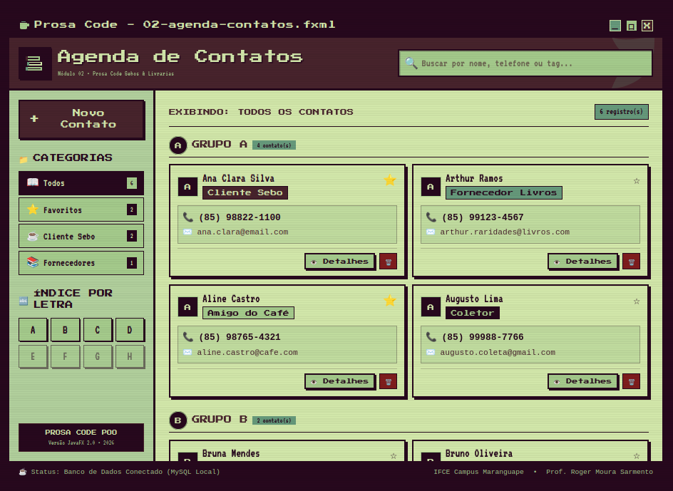
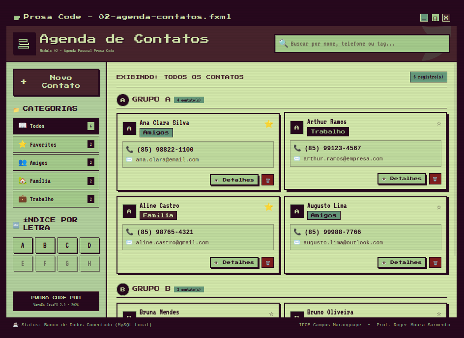

# 🎨 Mockups de Alta Fidelidade — Agenda de Contatos

Nesta pasta estão reunidos os protótipos digitais em *pixel art* desenvolvidos para a **Agenda de Contatos**, documentando a evolução do layout e o refinamento do escopo do módulo.

---

## 🔄 Evolução e Refinamento do Design

### 🔴 Versão 1: Conceito Inicial (Mistura de Escopos)

* **Histórico:** Na primeira proposta visual, conceitos do sistema principal do sebo foram incorporados por engano à agenda, incluindo categorias como *Cliente Sebo*, *Fornecedor Livros* e *Coletor*[cite: 11].
* **Decisão de Design:** A equipe identificou a mistura de regras de negócio e ajustou a agenda para operar como um módulo genérico e independente.

---

### 🟢 Versão 2: Versão Final (Agenda Pessoal / Padronizada)

* **Resultado Final:** Interface reestruturada para funcionar exclusivamente como uma **Agenda de Contatos Pessoal**.
* **Categorias Oficiais:** *Todos*, *Favoritos*, *Amigos*, *Família* e *Trabalho*.
* **Recursos de Navegação:**
  - 🔍 **Barra de Pesquisa:** Localização rápida por nome, telefone ou tag no topo.
  - 🗂️ **Filtro Lateral & Índice:** Navegação por grupos e filtro por letras (A, B, C, D...).
  - 📇 **Cartões de Contato:** Exibição individual com atalhos para *Detalhes* e *Excluir*.

---

## 🛠️ Especificações Técnicas de UI/UX

* **Arquivo FXML:** `02-agenda-contatos.fxml` (Projetado para **JavaFX**).
* **Paleta de Cores Aplicada:**
  - **Fundo Principal (`#D2E7AA`):** Leitura confortável dos cartões.
  - **Molduras e Barras (`#27081D`):** Contraste e definição de estrutura.
  - **Botões e Destaques (`#47232C` / `#A4CA8B`):** Identidade visual oficial Prosa Code.

---

## 🔙 Links Úteis
* ✏️ [Ver Esboço em Papel (Wireframe)](../wireframes/README.md)
* 🏠 [Voltar à Raiz do Repositório](../../../README.md)
