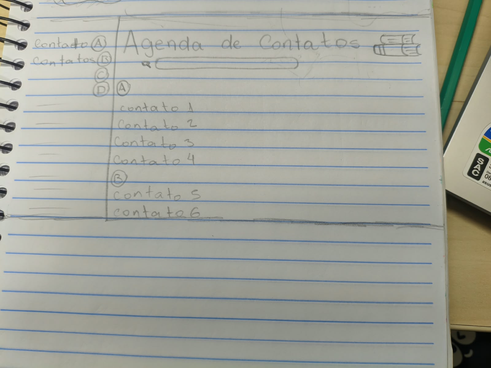

# ✏️ Esboço e Wireframe — Agenda de Contatos

Nesta seção está registrado o esboço inicial feito à mão (*wireframe de baixa fidelidade*) para o módulo de **Agenda de Contatos**.

  

### 📐 Estrutura Planejada no Esboço:
* **Cabeçalho:** Título da aplicação e campo de busca centralizado.
* **Menu Lateral:** Seleção por grupos/índice alfabético (A, B, C, D...).
* **Área Principal:** Listagem de contatos organizada em cartões agrupados por letra.
